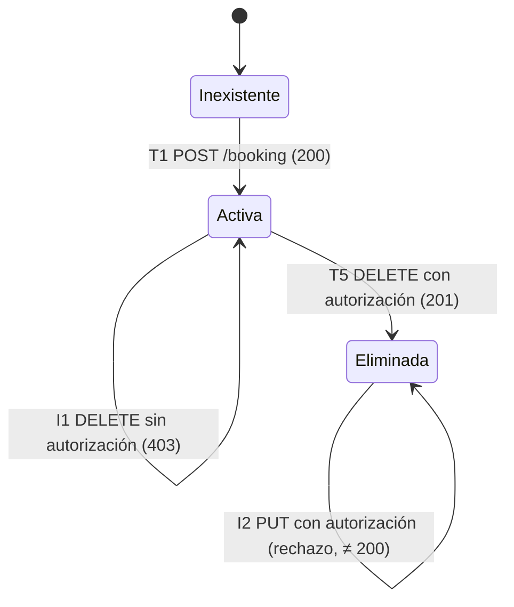
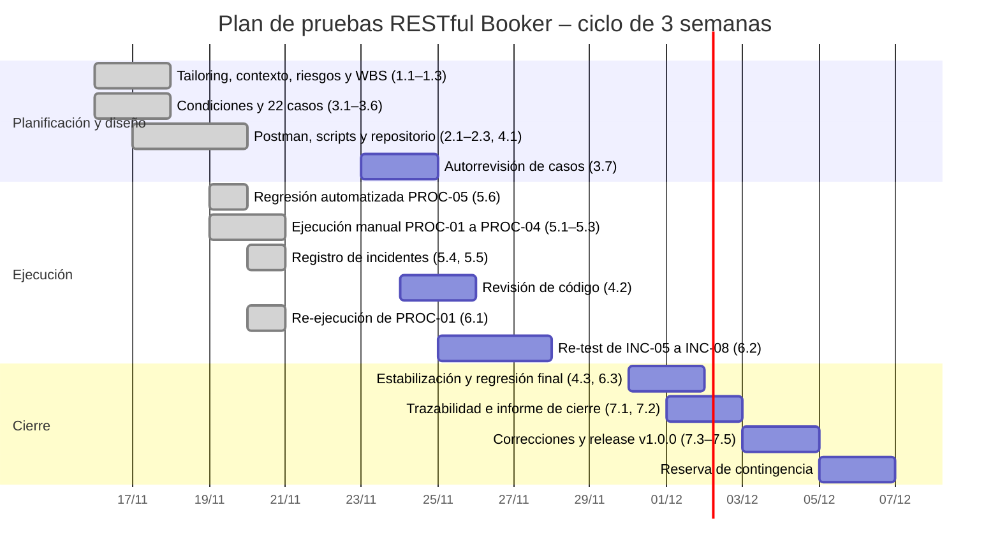

# Plan de pruebas de la API RESTful Booker – Módulo de reservas (v1.3)

> Plan de pruebas según ISO/IEC/IEEE 29119-3, con enfoque de pruebas basadas en riesgos (RBT).
> Los casos manuales están en este documento; los casos automatizados están en [`/tests`](../tests/flujos_criticos.spec.js).

## Tabla de contenido

1. [Información específica del documento](#1-información-específica-del-documento)
2. [Introducción y declaración de adaptación (tailoring)](#2-introducción-y-declaración-de-adaptación-tailoring)
3. [Contexto de las pruebas](#3-contexto-de-las-pruebas)
4. [Gestión de riesgos y matriz de exposición (RBT)](#4-gestión-de-riesgos-y-matriz-de-exposición-rbt)
5. [Estrategia de pruebas y derivación de casos](#5-estrategia-de-pruebas-y-derivación-de-casos)
6. [Actividades de prueba y estimaciones](#6-actividades-de-prueba-y-estimaciones)
7. [Personal](#7-personal)
8. [Cronograma](#8-cronograma)

---

## 1. Información específica del documento

### 1.1 Identificador único del documento

| Campo | Valor |
|---|---|
| Identificador | **PP-RB-2026-001** |
| Título | Plan de pruebas de la API RESTful Booker – Módulo de reservas |
| Versión | 1.3 |
| Estado | En ejecución: ciclo 1 completo (pendiente de firma del auditor) |
| Release de GitHub | `v1.0.0` |
| Commit de referencia | `<SHA del commit del release>` *(se completa al publicar el release)* |
| Ubicación | `/docs/plan-de-pruebas.md` del repositorio `plan-pruebas-restful-booker` |

El identificador sigue la convención `PP` (plan de pruebas) – `RB` (RESTful Booker) – año – consecutivo. Cada release de GitHub congela una versión del plan; el SHA del commit permite al auditor saber exactamente qué versión revisó.

### 1.2 Organización emisora y autores

| Campo | Detalle |
|---|---|
| Organización emisora | Institución Universitaria Pascual Bravo – Curso de Pruebas de Software – Equipo RESTful Booker |
| Autoría | **Susana Romero García** (Analista de pruebas): versiones 1.0 a 1.3 y todas las tareas del ciclo de pruebas · Miguel Angel Vallejo Giroldo (Test Manager): versiones 0.1 a 0.4 |
| Integrantes del equipo | Miguel Angel Vallejo Giroldo (Test Manager) · Susana Romero García (Analista de pruebas) · Luisa Fernanda Tamayo Arias (Analista de pruebas) · Santiago Montoya Restrepo (Automatizador) |
| Equipos revisores (coevaluación) | Mateo Villada, Keyner Gil, Jeyson González (actividad 1) · Nicolás Castaño, Julián Ramírez, Sebastián Díaz, Marcos Duque (actividad 2) |

### 1.3 Autoridad de aprobación

| Rol | Nombre | Responsabilidad | Firma / fecha |
|---|---|---|---|
| Auditor y autoridad de aprobación | Roberto José Calderón | Aprueba el plan, la declaración de tailoring y el release final | |
| Test Manager | Miguel Angel Vallejo Giroldo | Aprueba internamente cada versión antes de solicitar la revisión del auditor | Miguel Angel Vallejo – 19/11/2026 |

La aprobación se registra como *review* aprobado en el *pull request* que publica el release.

### 1.4 Historial de cambios y control de versiones

| Versión | Fecha | Autor | Descripción del cambio |
|---|---|---|---|
| 0.1 | 22/09/2026 | M. Vallejo | Inicio del plan: metodología ágil, objetivo general y alcance preliminar, con ajustes de la revisión cruzada. |
| 0.2 | 24/09/2026 | M. Vallejo | Identificación de los *test items* F01–F07, precondiciones y priorización. |
| 0.3 | 13/10/2026 | M. Vallejo | Matriz de riesgos v1.1 (R01–R07), técnicas, criterios de finalización y estimación inicial (30 h). |
| 0.4 | Oct/2026 | M. Vallejo | Especificación de casos TC-01 a TC-06 y procedimientos PROC-01 a PROC-03. |
| 1.0 | 17/11/2026 | S. Romero | Consolidación ISO 29119-3 + RBT: declaración de tailoring; matriz de riesgos v2.0 con 4 niveles y 19 riesgos; R01 se divide en R01 y R08; R06 se recalifica a Alto; TC-06 se retira (R05 aceptado); 22 casos con trazabilidad bidireccional; WBS de 94,5 h; cronograma de 3 semanas. |
| 1.1 | 20/11/2026 | S. Romero | Resultados del ciclo 1: 17 casos manuales ejecutados (12 pasan, 5 fallan) y 5 automatizados (5 pasan); 8 incidentes en `registro-incidentes.md`; resumen de ejecución en la sección 5.3.5. |
| 1.2 | 20/11/2026 | S. Romero | Asignación real de tareas: todo el ciclo (hecho y pendiente) queda a cargo de S. Romero; se adapta la regla de independencia (2.3 y 5.5), se recalcula la WBS (84 h, sección 6), se recalifica R19 a Medio y se actualiza el cronograma con lo ya ejecutado. |
| 1.3 | 20/11/2026 | S. Romero | Re-ejecución de PROC-01 en una sesión independiente (16:16): los 6 casos repiten su resultado; INC-01 a INC-04 quedan reproducidos. La regla de independencia pasa de "otra fecha" a "otra sesión". |

**Reglas de control de versiones**

- La rama `main` solo contiene versiones revisadas. Todo cambio entra por *pull request*, que deja registrado quién hizo cada cambio y cuándo.
- Cambio menor (redacción, datos de un caso): sube el segundo dígito (1.0 → 1.1). Cambio de alcance, de riesgos o de casos: sube el primer dígito (1.x → 2.0).
- Cada versión que se entrega al auditor se publica como *release* con *tag* (`v1.0.0`, `v1.1.0`, …).

---

## 2. Introducción y declaración de adaptación (tailoring)

### 2.1 Alcance del documento

Este documento es el **plan de pruebas de proyecto** para el módulo de reservas de la API RESTful Booker. Define qué se prueba, por qué, con qué técnicas, quién lo hace y cuándo, en un ciclo de **3 semanas** con **4 integrantes**.

**Objetivo general.** Verificar que las operaciones de gestión de reservas (consultar, crear, modificar total y parcialmente, y eliminar) de la API RESTful Booker funcionen según lo esperado y preserven la integridad de los datos, mediante pruebas funcionales de caja negra, abarcando de manera específica el módulo de reservas.

El documento cubre los niveles de **prueba de sistema** y **prueba de API** (caja negra), los tipos de prueba **funcional** y **de control de acceso básico**, y las fases de planificación, diseño, ejecución y cierre.

### 2.2 Referencias documentales

| ID | Documento |
|---|---|
| REF-01 | ISO/IEC/IEEE 29119-1. *Software testing – Part 1: Concepts and definitions.* |
| REF-02 | ISO/IEC/IEEE 29119-2. *Software testing – Part 2: Test processes.* |
| REF-03 | ISO/IEC/IEEE 29119-3:2013. *Software testing – Part 3: Test documentation* (edición usada en el curso; existe revisión 2021). |
| REF-04 | ISO/IEC/IEEE 29119-4. *Software testing – Part 4: Test techniques.* |
| REF-05 | Documentación oficial de la API RESTful Booker: <https://restful-booker.herokuapp.com/apidoc/index.html> |
| REF-06 | RFC 9110, *HTTP Semantics* (significado de los códigos de estado HTTP). |
| REF-07 | Entregables previos del equipo: Inicio del plan (22/09/2026), Actividad de test items (24/09/2026), Matriz de riesgos v1.1, Taller de estrategia (13/10/2026), Taller de especificación y procedimientos. |
| REF-08 | Documentación de Playwright Test (pruebas de API con el *fixture* `request`). |

### 2.3 Conformidad y adaptación (tailoring)

**Declaración.** Este plan declara **conformidad adaptada** (*tailored conformance*) con ISO/IEC/IEEE 29119-3. **No** se declara conformidad completa.

**Justificación del nivel de criticidad.** RESTful Booker es una API pública de práctica: no maneja datos reales de personas, dinero ni operaciones que afecten la vida o la seguridad de alguien. Un fallo no tiene consecuencias fuera del ejercicio académico. Por eso se clasifica como **software de criticidad baja**, y esa clasificación permite reducir la documentación y los procesos sin poner en riesgo a terceros.

**Restricciones que obligan a adaptar.**

1. **Tiempo:** ciclo cerrado de 3 semanas (planificación, ejecución y cierre).
2. **Personas:** el equipo tiene 4 integrantes, pero todas las tareas del ciclo las realiza una sola integrante (Susana Romero García).
3. **Acceso técnico:** no hay acceso al código fuente, a la base de datos ni a los registros (*logs*) del servidor; solo a la API pública.
4. **Entorno:** la instancia pública es compartida con otros usuarios y se reinicia cada 10 minutos.

**Procesos y documentos de la norma: decisión de adaptación**

| Elemento de ISO/IEC/IEEE 29119 | Decisión | Justificación | Riesgo que se asume al omitir o reducir | Compensación |
|---|---|---|---|---|
| Política de pruebas de la organización | **Excluido** | El equipo no es una organización con varios proyectos; no hay a quién aplicar una política. | No hay criterios corporativos que alineen este plan con otros proyectos. | Las reglas del equipo quedan en este plan (secc. 1.4 y README). |
| Estrategia organizacional de pruebas | **Excluido** | Misma razón: un solo proyecto. | Las decisiones de técnica no se heredan de un estándar interno. | La sección 5.2 justifica cada técnica. |
| Plan de pruebas | **Incluido** | Es este documento. | — | — |
| Especificación del diseño de pruebas | **Adaptado** | Se integra en las secciones 5.1 y 5.2 (condiciones y técnicas) en lugar de un documento aparte. | Menor detalle de los conjuntos de características. | Cada condición indica el *test item* y el riesgo. |
| Especificación de casos de prueba | **Incluido** | Sección 5.3 (manuales) y scripts en `/tests` (automatizados). | — | — |
| Especificación de procedimientos de prueba | **Adaptado** | 5 procedimientos breves dentro de la sección 5.3.3. | Menor detalle de pasos de preparación. | Colección de Postman con la preparación ya configurada. |
| Requisitos de datos y de entorno | **Adaptado** | Unificados en la sección 5.4. | — | — |
| Informes de preparación de datos y de entorno | **Excluido** | El entorno lo provee un tercero y no se puede preparar; se reemplaza por una prueba de humo. | Iniciar la ejecución con el entorno caído. | Criterio de entrada: `GET /ping` → 201 y token emitido (5.5). |
| Registro de ejecución | **Adaptado** | Columnas "Resultado real" y "Estado" en cada caso + reporte HTML de Playwright. | Menor detalle cronológico. | Evidencias con fecha y hora en `/docs/evidencias`. |
| Reporte de incidentes | **Incluido** | `docs/registro-incidentes.md`. | — | — |
| Informe de estado de pruebas | **Adaptado** | Se reemplaza por la revisión semanal de 30 min registrada en el *issue* de seguimiento. | Menor visibilidad formal del avance para terceros. | El auditor ve el avance en los *commits* y *pull requests*. |
| Informe de cierre de pruebas | **Incluido (simplificado)** | Se entrega en la semana 3 como parte del release. | — | — |
| Proceso de monitoreo y control (29119-2) | **Adaptado** | Un punto de control semanal en lugar de monitoreo continuo. | Detectar tarde una desviación del cronograma. | Columna "Estado" en la WBS y reserva de 9,5 h (32 % de la capacidad restante, secc. 6.2). |
| Independencia de las pruebas (diseñador ≠ ejecutor) | **Adaptado** | Una sola integrante diseña y ejecuta todos los casos. | Sesgo de confirmación: quien diseña tiende a "ver" el resultado que espera. | (1) Los resultados esperados quedaron versionados en GitHub el 19/11, antes de ejecutar (20/11); (2) cada caso tiene captura como evidencia; (3) los 5 automatizados los ejecuta GitHub Actions sin intervención humana; (4) re-ejecución de los casos fallidos en una sesión independiente: preparación nueva, datos nuevos y capturas nuevas (tarea 6.1). |

**Tipos de prueba excluidos y riesgo que se asume**

| Tipo de prueba excluido | Por qué se excluye | Riesgo residual asumido |
|---|---|---|
| Rendimiento y carga | Se necesitaría un entorno propio y herramientas de carga; además, sobrecargar una instancia pública compartida afecta a otros usuarios. | R13 y R14 (Bajo): no se sabrá cómo responde la API con muchos usuarios a la vez. |
| Seguridad profunda (inyección, fuerza bruta, expiración de tokens) | Fuera del alcance acordado en el inicio del plan; requiere conocimientos y permisos que el equipo no tiene en 3 semanas. | R11 y R12 (Medio): pueden existir vulnerabilidades no detectadas. **Solo se prueba el control de acceso básico (R06).** |
| Formatos alternativos (XML, `x-www-form-urlencoded`) | El objetivo se limita a JSON, que es el formato principal documentado. | R15 (Bajo): fallos en otros formatos no se detectarán. |
| Interfaz gráfica y código fuente | Exclusiones F06 y F07 aprobadas en la actividad 2. | No aplica: no son parte del objeto de prueba. |

### 2.4 Glosario

| Término | Definición usada en este plan |
|---|---|
| API REST | Interfaz que expone operaciones sobre recursos (aquí, reservas) mediante métodos HTTP. |
| Caja negra | Prueba basada solo en entradas y salidas observables, sin mirar el código. |
| Caso de prueba (TC) | Precondiciones, entradas y resultado esperado que verifican una condición de prueba. |
| Condición de prueba (CP) | Regla o comportamiento verificable que se deriva de un riesgo. |
| Exposición al riesgo (E) | Probabilidad × Impacto, cada uno calificado de 1 a 5. |
| Incidente (INC) | Diferencia entre el resultado esperado y el real, registrada para análisis. |
| Oráculo de prueba | Fuente que dice cuál es el resultado correcto (documentación, convenciones HTTP, reglas del equipo). |
| Partición de equivalencia (EP) | Técnica que divide los datos en clases que el sistema debería tratar igual y prueba un representante de cada una. |
| Análisis de valores límite (BVA) | Técnica que prueba los valores justo en el borde y al lado de cada frontera entre clases. |
| Transición de estados (ST) | Técnica que modela los estados del objeto (p. ej., reserva Activa o Eliminada) y prueba las transiciones válidas e inválidas. |
| Procedimiento (PROC) | Secuencia ordenada de casos con preparación y cierre. |
| RBT | *Risk-Based Testing*: se decide qué probar y con qué rigor según la exposición al riesgo. |
| Tailoring | Adaptación justificada de la norma a las condiciones del proyecto. |
| Token | Credencial temporal que emite `POST /auth` y que se envía como `Cookie: token=…`. |
| Trazabilidad bidireccional | Poder ir de un riesgo a sus casos y de cada caso a su riesgo sin huecos. |

---

## 3. Contexto de las pruebas

### 3.1 Elementos de prueba (test items)

**Objeto de prueba:** API RESTful Booker, instancia pública `https://restful-booker.herokuapp.com`, formato JSON. La API no expone un número de versión; por eso cada ejecución registra la **fecha y hora**, que identifican el estado del sistema probado.

| ID | Elemento | Endpoint | Requiere autorización | En alcance |
|---|---|---|---|---|
| F01 | Consultar reservas | `GET /booking/{id}` (y `GET /booking`) | No | Sí |
| F02 | Crear una reserva | `POST /booking` | No | Sí |
| F03 | Modificar una reserva | `PUT /booking/{id}` | Sí | Sí |
| F04 | Modificar parcialmente una reserva | `PATCH /booking/{id}` | Sí | Sí |
| F05 | Eliminar una reserva | `DELETE /booking/{id}` | Sí | Sí (solo de forma incidental, ver R05) |
| F08 | Autenticación | `POST /auth`, `Cookie: token=…` y `Authorization: Basic …` | — | Sí, como soporte de F03, F04 y F05 |
| F06 | Interfaz gráfica | — | — | No |
| F07 | Código fuente de la API | — | — | No |

> Se usa F08 para la autenticación y no se renumera, para mantener los identificadores F01–F07 de la actividad 2.

**Modelo de datos de una reserva** (campos de entrada de F02 y F03):

| Campo | Tipo | Obligatorio | Regla usada como oráculo |
|---|---|---|---|
| `firstname` | texto | Sí | No vacío |
| `lastname` | texto | Sí | No vacío |
| `totalprice` | número entero | Sí | ≥ 0 |
| `depositpaid` | booleano | Sí | `true` o `false` |
| `bookingdates.checkin` | fecha `AAAA-MM-DD` | Sí | Fecha de calendario existente |
| `bookingdates.checkout` | fecha `AAAA-MM-DD` | Sí | Posterior a `checkin` (mínimo 1 noche) |
| `additionalneeds` | texto | No | — |

### 3.2 Alcance y exclusiones de las pruebas

**Dentro del alcance**

- Creación de reservas con datos válidos e inválidos (F02).
- Modificación total y parcial con autorización válida, inválida y ausente (F03, F04, F08).
- Consulta de una reserva por ID existente e inexistente (F01).
- Ciclo de vida completo de la reserva: creación → consulta → modificación → eliminación (F01–F05).
- Control de acceso básico: que las operaciones protegidas no se ejecuten sin credenciales válidas (F08).

**Exclusiones explícitas**

| Exclusión | Motivo |
|---|---|
| Interfaz gráfica (F06) y código fuente (F07) | El objeto de prueba es la API y el enfoque es de caja negra. |
| Filtros de búsqueda de `GET /booking?firstname=…` como objetivo de prueba | Riesgo R09 Medio aceptado (secc. 4.3). Se usan solo como apoyo para verificar resultados. |
| Pruebas de casos dedicados a `DELETE` | Riesgo R05 Bajo aceptado; la eliminación se ejerce en TC-20 y en el cierre de cada procedimiento. |
| Rendimiento, carga, seguridad profunda y formatos XML/urlencoded | Ver la declaración de tailoring (2.3). |
| `GET /ping` como objetivo de prueba | Solo se usa como verificación de disponibilidad del entorno. |

### 3.3 Suposiciones y restricciones

**Suposiciones**

| ID | Suposición | Consecuencia si es falsa |
|---|---|---|
| S-01 | No existe una especificación formal de requisitos. El **oráculo** es, en este orden: (1) la documentación oficial de la API; (2) la semántica HTTP del RFC 9110; (3) reglas de negocio razonables definidas por el equipo (salida posterior a la entrada, precio ≥ 0, fechas válidas, campos obligatorios). | Algunos "fallos" podrían ser decisiones de diseño. Cada incidente indica qué fuente del oráculo usó. |
| S-02 | Las credenciales de prueba publicadas (`admin` / `password123`) siguen vigentes. | Se bloquean R02, R04 y R06 → criterio de suspensión (5.5). |
| S-03 | Susana Romero realiza todas las tareas; para las semanas 2 y 3 dedica 15 h por semana. | Se usa la reserva de 9,5 h y, si no alcanza, se recorta según el orden de la sección 6.2. |
| S-04 | La API es de un tercero: **el equipo no puede corregir los defectos**. El re-test confirma que el defecto es reproducible y lo documenta como riesgo residual. | — |
| S-05 | La ejecutora tiene experiencia limitada en automatización (riesgo R17). | Los scripts se ejecutan en GitHub Actions; si fallan, se usa la tarea 4.3 de depuración. |

**Restricciones**

| ID | Restricción |
|---|---|
| RS-01 | Ciclo de 3 semanas, del 16/11/2026 al 06/12/2026. |
| RS-02 | Sin acceso a código fuente, base de datos ni *logs* del servidor (caja negra). |
| RS-03 | La instancia pública se reinicia cada 10 minutos y es compartida: cada procedimiento debe ejecutarse completo en una sola sesión corta y con datos propios. |
| RS-04 | Sin control sobre la disponibilidad del servicio. |
| RS-05 | Toda la documentación se escribe en Markdown y se versiona en GitHub. |

### 3.4 Partes interesadas

| Parte interesada | Interés | Qué consume de este plan |
|---|---|---|
| Docente (auditor) | Verificar el cumplimiento de la norma adaptada, la trazabilidad y el rigor técnico. | Todo el plan, la matriz de trazabilidad y el release. |
| Test Manager | Que el plan sea viable y coherente. | Matriz de riesgos, WBS, cronograma. |
| Analistas y automatizador | Saber qué diseñar, ejecutar y programar. | Secciones 5, 6 y 7. |
| Equipos revisores (pares) | Evaluar la claridad y la coherencia. | Secciones 1 a 4. |
| Propietario de la API (externo, no participa) | Conocer los defectos encontrados. | Registro de incidentes (opcional). |

---

## 4. Gestión de riesgos y matriz de exposición (RBT)

### 4.1 Identificación de riesgos

La matriz v1.1 tenía 7 riesgos. En esta versión 2.0 se completó el listado para cubrir funcionalidad, seguridad, rendimiento y proyecto. Cambios respecto a la v1.1:

- **R01 se divide.** La v1.1 mezclaba dos fallos distintos: "una reserva válida se guarda mal" (sigue como **R01**) y "la API acepta datos inválidos" (nuevo **R08**). Separarlos permite calificarlos y probarlos con técnicas diferentes.
- **R06 se recalifica** de probabilidad 2 a 3. La API acepta **dos** mecanismos de autorización (`Cookie: token=…` y `Authorization: Basic …`), lo que duplica los puntos donde puede fallar el control de acceso.
- **Se agregan** R08 a R19.

**Escalas**

| Valor | Probabilidad (P) | Impacto (I) |
|---|---|---|
| 1 | Muy improbable | Insignificante: no afecta los datos ni el uso |
| 2 | Improbable | Menor: molestia, hay alternativa |
| 3 | Posible | Moderado: afecta una operación, sin pérdida de datos |
| 4 | Probable | Alto: datos incorrectos o una operación clave inutilizable |
| 5 | Casi seguro | Muy alto: pérdida o corrupción de reservas, o acceso no autorizado |

**Riesgos de producto**

| ID | Categoría | Elemento | Riesgo identificado | P | I | E | Nivel |
|---|---|---|---|---|---|---|---|
| R08 | Funcional – validación | F02 | La API acepta y guarda reservas con datos inválidos (salida antes o igual que la entrada, precio negativo, tipos o fechas inválidas, campos obligatorios ausentes). La documentación no define validaciones y la API es de práctica, por eso P = 4. | 4 | 5 | 20 | 🟥 Crítico |
| R01 | Funcional | F02 | Una reserva con datos válidos no se crea o se guarda con valores distintos a los enviados. | 3 | 5 | 15 | 🟧 Alto |
| R02 | Funcional | F03 | La modificación total no actualiza correctamente todos los datos, o altera la reserva aunque el cuerpo sea inválido o la reserva ya no exista. | 3 | 5 | 15 | 🟧 Alto |
| R06 | Seguridad – control de acceso | F08 | Las operaciones protegidas (modificar, eliminar) se ejecutan sin una autorización válida, o se rechaza una autorización válida. | 3 | 5 | 15 | 🟧 Alto |
| R03 | Funcional | F01 | La consulta no devuelve la reserva solicitada o devuelve información incorrecta. | 3 | 4 | 12 | 🟨 Medio |
| R04 | Funcional | F04 | La modificación parcial cambia campos que no fueron enviados en la solicitud. | 3 | 4 | 12 | 🟨 Medio |
| R10 | Robustez | F02–F05 | Ante datos erróneos la API responde con códigos HTTP incorrectos (p. ej., 500 en lugar de 400) o sin mensaje útil. | 4 | 3 | 12 | 🟨 Medio |
| R12 | Seguridad | F02–F04 | Entradas maliciosas (scripts o inyección en campos de texto) se aceptan y se guardan. | 3 | 4 | 12 | 🟨 Medio |
| R09 | Funcional | F01 | Los filtros de búsqueda de `GET /booking` devuelven resultados incorrectos. | 3 | 3 | 9 | 🟨 Medio |
| R11 | Seguridad | F08 | El token no expira y puede reutilizarse indefinidamente. | 3 | 3 | 9 | 🟨 Medio |
| R05 | Funcional | F05 | La reserva no se elimina o sigue disponible después de eliminarla. | 2 | 4 | 8 | 🟩 Bajo |
| R13 | Rendimiento | F01–F05 | El tiempo de respuesta de una operación individual supera 2 s. | 3 | 2 | 6 | 🟩 Bajo |
| R14 | Rendimiento | F01–F05 | La API se degrada con muchas solicitudes simultáneas. | 2 | 3 | 6 | 🟩 Bajo |
| R15 | Compatibilidad | F02–F04 | Fallos al usar formatos XML o `x-www-form-urlencoded`. | 2 | 2 | 4 | 🟩 Bajo |

**Riesgos de proyecto**

| ID | Categoría | Riesgo identificado | P | I | E | Nivel |
|---|---|---|---|---|---|---|
| R07 | Entorno | La instancia pública se reinicia cada 10 minutos o no está disponible, lo que borra datos y altera la ejecución. | 4 | 3 | 12 | 🟨 Medio |
| R18 | Tiempo | El ciclo de 3 semanas no alcanza y se retrasa la entrega. | 3 | 4 | 12 | 🟨 Medio |
| R17 | Conocimiento | Curva de aprendizaje de Playwright retrasa la automatización. | 3 | 3 | 9 | 🟨 Medio |
| R16 | Datos | Otros usuarios de la instancia pública crean reservas con los mismos nombres y contaminan las verificaciones. | 4 | 2 | 8 | 🟩 Bajo |
| R19 | Personas | Ausencia o sobrecarga de la única integrante que ejecuta las tareas (dependencia de una sola persona). Recalificado en v1.2: P de 2 a 3. | 3 | 4 | 12 | 🟨 Medio |

### 4.2 Matriz de análisis de riesgos

**Regla de clasificación** (E = P × I, de 1 a 25):

| Nivel | Rango de E | Prioridad de ejecución |
|---|---|---|
| 🟥 Crítico | 20 – 25 | P1 |
| 🟧 Alto | 15 – 19 | P1 |
| 🟨 Medio | 9 – 14 | P2 |
| 🟩 Bajo | 1 – 8 | No se ejecuta (aceptado) |

> Los umbrales Alto ≥ 15 y Bajo ≤ 8 se conservan de la matriz v1.1; se agrega el nivel Crítico (E ≥ 20) que exige la estructura del plan, por lo que ningún riesgo anterior cambia de nivel por la escala.

**Mapa de calor (probabilidad × impacto)**

| P \ I | 1 Insignificante | 2 Menor | 3 Moderado | 4 Alto | 5 Muy alto |
|---|---|---|---|---|---|
| **5 Casi seguro** | 🟩 5 | 🟨 10 | 🟧 15 | 🟥 20 | 🟥 25 |
| **4 Probable** | 🟩 4 | 🟩 8 · R16 | 🟨 12 · R07, R10 | 🟧 16 | 🟥 20 · **R08** |
| **3 Posible** | 🟩 3 | 🟩 6 · R13 | 🟨 9 · R09, R11, R17 | 🟨 12 · R03, R04, R12, R18, R19 | 🟧 15 · **R01, R02, R06** |
| **2 Improbable** | 🟩 2 | 🟩 4 · R15 | 🟩 6 · R14 | 🟩 8 · R05 | 🟨 10 |
| **1 Muy improbable** | 🟩 1 | 🟩 2 | 🟩 3 | 🟩 4 | 🟩 5 |

**Resumen:** 1 Crítico, 3 Altos, 10 Medios y 5 Bajos (19 riesgos: 14 de producto y 5 de proyecto).

### 4.3 Tratamiento y mitigación

| Riesgo | Nivel | Tratamiento | Cómo se trata | Casos |
|---|---|---|---|---|
| R08 | Crítico | **Mitigar con pruebas (obligatorio)** | BVA y EP sobre cada regla de validación de la creación. | TC-01, TC-02, TC-07 a TC-13 |
| R01 | Alto | **Mitigar con pruebas (obligatorio)** | EP de la clase válida y comparación campo a campo entre lo enviado y lo guardado. | TC-02, TC-09, TC-19, TC-20 |
| R02 | Alto | **Mitigar con pruebas (obligatorio)** | EP del cuerpo de `PUT` y transición de estados (modificar una reserva eliminada). | TC-03, TC-14, TC-20, TC-22 |
| R06 | Alto | **Mitigar con pruebas (obligatorio)** | EP de las clases de autorización (ninguna, Cookie válida/inválida, Basic válida/inválida, credenciales de `/auth`). | TC-15, TC-16, TC-18, TC-20, TC-21, TC-23 |
| R03 | Medio | **Mitigar con pruebas (opción justificada)** | `GET /booking/{id}` es el **oráculo** de casi todos los demás casos: si la consulta falla, ningún otro resultado es confiable. Probarla cuesta 2 casos. | TC-04, TC-17 |
| R04 | Medio | **Mitigar con pruebas (opción justificada)** | El objetivo general exige preservar la integridad de los datos, y `PATCH` es la operación con más riesgo de cambiar datos no enviados. Reutiliza la reserva base de PROC-04, así que su costo es marginal. | TC-05, TC-20 |
| R10 | Medio | **Mitigación indirecta, sin casos dedicados** | Los casos de R08 esperan un código 4xx; si la API responde 500, se registra un incidente de R10. | (TC-01, TC-07, TC-08, TC-10 a TC-14) |
| R09 | Medio | **Aceptar** | Los filtros no son una operación de gestión de reservas ni están en el objetivo general. | — |
| R11, R12 | Medio | **Aceptar (excluido por tailoring)** | Seguridad profunda fuera de alcance (2.3). Riesgo residual declarado en el informe de cierre. | — |
| R05 | Bajo | **Aceptar** | Sin casos dedicados. Se ejerce de forma incidental en TC-20 (transición T5 → T6) y en el cierre de todos los procedimientos. Por eso se retira TC-06 de la versión 0.4. | — |
| R13, R14, R15 | Bajo | **Aceptar (excluido por tailoring)** | Fuera de alcance. Si en la ejecución se observa una respuesta > 2 s, se anota sin abrir incidente. | — |
| R07 | Medio (proyecto) | **Mitigar con acciones** | Cada procedimiento se ejecuta completo en menos de 10 min y crea sus propios datos; los scripts reintentan una vez; si una reserva desaparece, se marca "Bloqueado", no "Falla". | — |
| R18 | Medio (proyecto) | **Mitigar con acciones** | La ejecución y la re-ejecución de PROC-01 se adelantaron a la semana 1; quedan 20,5 h para dos semanas con 9,5 h de reserva. | — |
| R17 | Medio (proyecto) | **Mitigar con acciones** | Scripts verificados primero con un simulador local y luego en GitHub Actions (5 de 5 en verde el 19/11). | — |
| R16 | Bajo (proyecto) | **Aceptar con acción preventiva de costo cero** | Apellidos únicos con marca de tiempo (`Prueba-{{sufijo}}`). | — |
| R19 | Medio (proyecto) | **Mitigar con acciones** | Todo está versionado en GitHub (plan, colección, scripts y evidencias): cualquier integrante puede retomar el trabajo, y GitHub Actions ejecuta la regresión sin depender de nadie. | — |

**Resultado:** el 100 % de los riesgos Críticos y Altos (R08, R01, R02, R06) queda mitigado con casos de prueba.

---

## 5. Estrategia de pruebas y derivación de casos

La cadena de diseño es siempre la misma, y cada eslabón tiene un identificador:

```text
Riesgo (R) ──► Condición de prueba (CP) ──► Técnica (EP / BVA / ST) ──► Caso de prueba (TC)
  sección 4.3        sección 5.1                 sección 5.2                sección 5.3
```

### 5.1 Derivación de condiciones de prueba

Cada riesgo que la sección 4.3 manda mitigar con pruebas se traduce en una o más condiciones verificables.

| CP | Riesgo(s) | Elemento | Condición de prueba (qué debe cumplirse) |
|---|---|---|---|
| CP-01 | R01 | F02 | Una reserva con todos los campos válidos se crea (200, con `bookingid`) y se guarda con valores idénticos a los enviados. |
| CP-02 | R08, R01 | F02 | La salida (`checkout`) debe ser posterior a la entrada (`checkin`): con 0 noches o menos la creación se rechaza; con 1 noche se acepta. |
| CP-03 | R08, R01 | F02 | `totalprice` debe ser un número entero ≥ 0: un precio negativo o no numérico se rechaza; 0 se acepta. |
| CP-04 | R08 | F02 | La creación exige todos los campos obligatorios y el encabezado `Content-Type: application/json`; si falta alguno, se rechaza con 4xx (no con 500, ver R10) y no se crea nada. |
| CP-05 | R08 | F02 | Las fechas deben ser fechas de calendario existentes en formato `AAAA-MM-DD`; una fecha inexistente se rechaza. |
| CP-06 | R02 | F03 | Un `PUT` autorizado con cuerpo completo y válido reemplaza todos los campos de la reserva. |
| CP-07 | R02 | F03 | Un `PUT` autorizado con cuerpo incompleto se rechaza con 4xx y la reserva queda sin cambios. |
| CP-08 | R06 | F03, F05, F08 | Las operaciones protegidas solo se ejecutan con una autorización válida (Cookie con token vigente o Basic correcta); en cualquier otro caso responden 403 y no cambian nada. |
| CP-09 | R06 | F08 | `POST /auth` solo emite un token si las credenciales son válidas. |
| CP-10 | R01, R02, R04, R06 | F01–F05 | El ciclo de vida de la reserva respeta el modelo de estados (Inexistente → Activa → Eliminada) y rechaza las transiciones inválidas. |
| CP-11 | R03 | F01 | `GET /booking/{id}` devuelve 200 con los datos correctos si el ID existe, y 404 si no existe. |
| CP-12 | R04 | F04 | Un `PATCH` autorizado modifica solo los campos enviados y conserva los demás. |

### 5.2 Técnicas de diseño de pruebas

Se usan tres técnicas de caja negra de ISO/IEC/IEEE 29119-4. Cada caso declara cuál técnica generó sus datos.

| Técnica | Se aplica a | Por qué esta técnica | Cobertura que se busca |
|---|---|---|---|
| **Partición de equivalencia (EP)** | CP-01, CP-03 (tipo), CP-04, CP-05, CP-06, CP-07, CP-08, CP-09, CP-11, CP-12 | Las entradas se agrupan en clases que la API debería tratar igual (p. ej., "autorización ausente"); con un representante por clase se cubre cada comportamiento sin repetir pruebas. | 100 % de las clases definidas abajo. |
| **Análisis de valores límite (BVA)** | CP-02, CP-03 | Las reglas de fechas y precio tienen una frontera numérica; los errores de programación (usar `>` en lugar de `≥`) aparecen justo en la frontera. | 100 % de los valores límite definidos abajo. |
| **Transición de estados (ST)** | CP-10 | La reserva tiene estados (existe, eliminada) y el resultado de una operación depende del estado en que se encuentre. | Cobertura 0-switch: todas las transiciones válidas una vez + 2 transiciones inválidas de mayor riesgo. |

> **Nota sobre tablas de decisión.** El taller del 13/10/2026 proponía una tabla de decisión para R01 (campos obligatorios × `Content-Type`). Al analizarla, las dos condiciones son **independientes** y cualquier combinación con una condición falsa produce la misma acción (rechazo). Una tabla con acciones idénticas se reduce a particiones, por eso se modela con EP (CP-04) y se ahorran casos redundantes.

#### 5.2.1 BVA: duración de la estadía (CP-02)

Variable: `noches = checkout − checkin` (en días). Clase inválida: `noches ≤ 0`. Clase válida: `noches ≥ 1`. Frontera: entre 0 y 1. Se usa **BVA de 3 valores** sobre el máximo de la clase inválida (0): sus vecinos −1 y 1.

| Valor | Clase | `checkin` | `checkout` | Resultado esperado | Caso |
|---|---|---|---|---|---|
| −1 | Inválida | 2026-12-10 | 2026-12-09 | Rechazo (4xx) | TC-01 |
| 0 | Inválida (límite) | 2026-12-10 | 2026-12-10 | Rechazo (4xx) | TC-07 |
| 1 | Válida (límite) | 2026-12-10 | 2026-12-11 | 200 + `bookingid` | TC-02 |

#### 5.2.2 BVA y EP: precio total (CP-03)

Variable: `totalprice`. Clase inválida numérica: `≤ −1`. Clase válida: `≥ 0`. Clase inválida de tipo: valor no numérico. **BVA de 2 valores** en la frontera (−1 | 0) + un representante de la clase de tipo inválido. No hay límite superior documentado, así que no se prueba un máximo (se deja como observación).

| Valor | Clase | Resultado esperado | Caso |
|---|---|---|---|
| −1 | Inválida (límite) | Rechazo (4xx) | TC-08 |
| 0 | Válida (límite) | 200 + `bookingid` | TC-09 |
| `"cien"` | Inválida (tipo) | Rechazo (4xx) | TC-10 |

#### 5.2.3 EP: estructura y formato de la creación (CP-01, CP-04, CP-05)

| Clase | Tipo | Representante | Caso |
|---|---|---|---|
| Todos los campos válidos y `Content-Type: application/json` | Válida | Reserva completa de DAT-01 | TC-19 (también TC-02 y TC-09) |
| Falta un campo obligatorio | Inválida | Sin `lastname` | TC-11 |
| `Content-Type` distinto de JSON | Inválida | `text/plain` | TC-12 |
| Fecha con formato correcto pero inexistente | Inválida | `checkin = 2026-02-30` | TC-13 |

#### 5.2.4 EP: modificación, consulta y autorización (CP-06 a CP-09, CP-11, CP-12)

| Variable | Clases válidas → representante | Clases inválidas → representante |
|---|---|---|
| Cuerpo de `PUT` | Completo y válido → TC-03 | Incompleto (sin `bookingdates`) → TC-14 |
| Autorización de `PUT`/`DELETE` | Cookie con token vigente → TC-03; Basic `admin:password123` → TC-23 | Ninguna → TC-15 (`PUT`), TC-21 (`DELETE`); Cookie con token inventado → TC-16; Basic con contraseña incorrecta → TC-23 |
| Credenciales de `POST /auth` | `admin` / `password123` → preparación de cada procedimiento | Contraseña incorrecta → TC-18 |
| ID de `GET /booking/{id}` | ID existente → TC-04 | ID numérico inexistente (`999999999`) → TC-17 |
| Cuerpo de `PATCH` | Un solo campo (`firstname`) → TC-05 | — (no se define clase inválida: riesgo Medio, alcance mínimo) |

#### 5.2.5 Transición de estados: ciclo de vida de una reserva (CP-10)



| Transición | Estado inicial | Evento | Estado final | Respuesta esperada | Tipo | Caso |
|---|---|---|---|---|---|---|
| T1 | Inexistente | `POST /booking` válido | Activa | 200 | Válida | TC-20 |
| T2 | Activa | `GET /booking/{id}` | Activa | 200 + datos | Válida | TC-20 |
| T3 | Activa | `PUT` con token | Activa | 200 | Válida | TC-20 |
| T4 | Activa | `PATCH` con token | Activa | 200 | Válida | TC-20 |
| T5 | Activa | `DELETE` con token | Eliminada | 201 (definido por la documentación) | Válida | TC-20 |
| T6 | Eliminada | `GET /booking/{id}` | Eliminada | 404 | Válida | TC-20 |
| I1 | Activa | `DELETE` sin autorización | Activa | 403 | Inválida | TC-21 |
| I2 | Eliminada | `PUT` con token | Eliminada | ≠ 200 y luego `GET` → 404 | Inválida | TC-22 |

Cobertura 0-switch: 6 de 6 transiciones válidas (100 %) y 2 transiciones inválidas elegidas por riesgo (R06 e integridad de R02).

### 5.3 Generación de casos de prueba y trazabilidad

**Volumen:** 22 casos = **17 manuales** + **5 automatizados**. Todos los diseñó Susana Romero.

**Prioridad:** P1 para casos de riesgos Crítico y Alto; P2 para riesgos Medio.

**Convenciones para los datos manuales**

- `{{baseUrl}}` = `https://restful-booker.herokuapp.com`.
- `{{sufijo}}` = marca de tiempo única que genera la colección de Postman al iniciar cada procedimiento (mitiga R16).
- Encabezados en todas las solicitudes: `Content-Type: application/json` y `Accept: application/json` (salvo que el caso diga otra cosa).
- **Reserva base (DAT-01):**

```json
{
  "firstname": "Ana",
  "lastname": "Prueba-{{sufijo}}",
  "totalprice": 150,
  "depositpaid": true,
  "bookingdates": { "checkin": "2026-12-10", "checkout": "2026-12-11" },
  "additionalneeds": "Breakfast"
}
```

- **Rechazo esperado:** se espera **400**. Cualquier 4xx cuenta como rechazo correcto de R08. Un **500** cuenta como rechazo para R08, pero se registra un incidente de **R10**. Un **200** es un fallo de R08.
- **Estado del caso:** ✅ Pasa · ❌ Falla (se abre INC) · ⛔ Bloqueado (el entorno no permitió ejecutarlo, ver R07).

#### 5.3.1 Casos manuales

##### TC-01 · Rechazar una reserva cuya salida es un día antes de la entrada

| Campo | Detalle |
|---|---|
| Riesgo · Condición · Prioridad | R08 (Crítico) · CP-02 · P1 |
| Técnica y origen de los datos | BVA de 3 valores, valor −1 noches (vecino inferior del límite inválido 0). Caso piloto de la versión 0.4. |
| Diseña / Ejecuta | Susana Romero / Susana Romero |
| Procedimiento | PROC-01 |
| Precondiciones | `GET /ping` → 201. |
| Entrada | `POST {{baseUrl}}/booking` con DAT-01, `lastname: "Prueba-{{sufijo}}-TC01"`, `checkin: "2026-12-10"`, `checkout: "2026-12-09"`. |
| Resultado esperado | Rechazo (400). La respuesta no contiene `bookingid`. `GET /booking?firstname=Ana&lastname=Prueba-{{sufijo}}-TC01` devuelve `[]`. |
| Resultado real | POST → **200 OK** con `bookingid` 991: la API **aceptó** `checkout` 2026-12-09 anterior a `checkin` 2026-12-10. Verificación por apellido → `[{"bookingid": 991}]`: la reserva quedó guardada. Evidencia: [POST](evidencias/TC-01_20261120.png) · [verificación](evidencias/TC-01_verif_20261120.png)<br>**Re-ejecución (sesión independiente, 20/11/2026 16:16):** **200 OK** con `bookingid` 3756 (salida 2026-12-09 antes de entrada 2026-12-10); verificación → `[{"bookingid": 3756}]`. Evidencia: [POST](evidencias/TC-01_rerun_20261120-1616.png) · [verificación](evidencias/TC-01_rerun_verif_20261120-1616.png) |
| Estado / Incidente | ❌ Falla · [INC-01](registro-incidentes.md#inc-01) · Ejecutó: Susana Romero · 20/11/2026 · 🔁 Re-ejecución 20/11 16:16: ❌ Falla reproducida |

##### TC-02 · Crear una reserva de una noche (estadía mínima válida)

| Campo | Detalle |
|---|---|
| Riesgo · Condición · Prioridad | R08 (Crítico), R01 (Alto) · CP-02 · P1 |
| Técnica y origen de los datos | BVA de 3 valores, valor +1 noche (primer valor de la clase válida). |
| Diseña / Ejecuta | Susana Romero / Susana Romero |
| Procedimiento | PROC-01 |
| Precondiciones | `GET /ping` → 201. |
| Entrada | `POST {{baseUrl}}/booking` con DAT-01, `lastname: "Prueba-{{sufijo}}-TC02"`, `checkin: "2026-12-10"`, `checkout: "2026-12-11"`. |
| Resultado esperado | 200 con `bookingid` y `booking` igual a lo enviado. `GET /booking/{bookingid}` → 200 con los mismos datos. |
| Resultado real | POST → **200 OK** con `bookingid` 1515 y `booking` igual a lo enviado. Verificación `GET /booking/1515` → 200 con los mismos datos. Evidencia: [POST](evidencias/TC-02_20261119-1640.png) · [verificación](evidencias/TC-02_verif_20261119-1640.png)<br>**Re-ejecución (sesión independiente, 20/11/2026 16:16):** **200 OK** con `bookingid` 2868; verificación → 200 con los mismos datos. Evidencia: [POST](evidencias/TC-02_rerun_20261120-1616.png) · [verificación](evidencias/TC-02_rerun_verif_20261120-1616.png) |
| Estado / Incidente | ✅ Pasa · Ejecutó: Susana Romero · 19/11/2026 · 🔁 Re-ejecución 20/11 16:16: ✅ Pasa (confirmado) |

##### TC-07 · Rechazar una reserva con 0 noches (entrada y salida el mismo día)

| Campo | Detalle |
|---|---|
| Riesgo · Condición · Prioridad | R08 (Crítico) · CP-02 · P1 |
| Técnica y origen de los datos | BVA de 3 valores, valor 0 noches (límite de la clase inválida). |
| Diseña / Ejecuta | Susana Romero / Susana Romero |
| Procedimiento | PROC-01 |
| Precondiciones | `GET /ping` → 201. |
| Entrada | `POST {{baseUrl}}/booking` con DAT-01, `lastname: "Prueba-{{sufijo}}-TC07"`, `checkin: "2026-12-10"`, `checkout: "2026-12-10"`. |
| Resultado esperado | Rechazo (400). Sin `bookingid`. El filtro por `lastname` devuelve `[]`. |
| Resultado real | POST → **200 OK** con `bookingid` 1907: la API **aceptó** `checkin` = `checkout` = 2026-12-10 (0 noches). Verificación por apellido → `[{"bookingid": 1907}]`. Evidencia: [POST](evidencias/TC-07_20261120.png) · [verificación](evidencias/TC-07_verif_20261120.png)<br>**Re-ejecución (sesión independiente, 20/11/2026 16:16):** **200 OK** con `bookingid` 4101 (0 noches); verificación → `[{"bookingid": 4101}]`. Evidencia: [POST](evidencias/TC-07_rerun_20261120-1616.png) · [verificación](evidencias/TC-07_rerun_verif_20261120-1616.png) |
| Estado / Incidente | ❌ Falla · [INC-02](registro-incidentes.md#inc-02) · Ejecutó: Susana Romero · 20/11/2026 · 🔁 Re-ejecución 20/11 16:16: ❌ Falla reproducida |

##### TC-08 · Rechazar una reserva con precio negativo

| Campo | Detalle |
|---|---|
| Riesgo · Condición · Prioridad | R08 (Crítico) · CP-03 · P1 |
| Técnica y origen de los datos | BVA de 2 valores, valor −1 (límite de la clase inválida `≤ −1`). |
| Diseña / Ejecuta | Susana Romero / Susana Romero |
| Procedimiento | PROC-01 |
| Precondiciones | `GET /ping` → 201. |
| Entrada | `POST {{baseUrl}}/booking` con DAT-01, `lastname: "Prueba-{{sufijo}}-TC08"`, `totalprice: -1`. |
| Resultado esperado | Rechazo (400). Sin `bookingid`. El filtro por `lastname` devuelve `[]`. |
| Resultado real | POST → **200 OK** con `bookingid` 2766 y `totalprice: -1` guardado. Verificación por apellido → `[{"bookingid": 2766}]`. Evidencia: [POST](evidencias/TC-08_20261120.png) · [verificación](evidencias/TC-08_verif_20261120.png)<br>**Re-ejecución (sesión independiente, 20/11/2026 16:16):** **200 OK** con `bookingid` 4497 y `totalprice: -1`; verificación → `[{"bookingid": 4497}]`. Evidencia: [POST](evidencias/TC-08_rerun_20261120-1616.png) · [verificación](evidencias/TC-08_rerun_verif_20261120-1616.png) |
| Estado / Incidente | ❌ Falla · [INC-03](registro-incidentes.md#inc-03) · Ejecutó: Susana Romero · 20/11/2026 · 🔁 Re-ejecución 20/11 16:16: ❌ Falla reproducida |

##### TC-09 · Crear una reserva con precio 0

| Campo | Detalle |
|---|---|
| Riesgo · Condición · Prioridad | R08 (Crítico), R01 (Alto) · CP-03 · P1 |
| Técnica y origen de los datos | BVA de 2 valores, valor 0 (límite de la clase válida `≥ 0`). |
| Diseña / Ejecuta | Susana Romero / Susana Romero |
| Procedimiento | PROC-01 |
| Precondiciones | `GET /ping` → 201. |
| Entrada | `POST {{baseUrl}}/booking` con DAT-01, `lastname: "Prueba-{{sufijo}}-TC09"`, `totalprice: 0`. |
| Resultado esperado | 200 con `bookingid`; `GET /booking/{bookingid}` muestra `totalprice: 0` y el resto igual a lo enviado. |
| Resultado real | POST → **200 OK** con `bookingid` y `totalprice: 0`. Verificación `GET /booking/{id}` → 200 con `totalprice: 0` y el resto igual. *Observación: la captura del POST corresponde al envío del 19/11 (sufijo distinto al de la verificación); retomar en la re-ejecución.* Evidencia: [POST](evidencias/TC-09_20261120.png) · [verificación](evidencias/TC-09_verif_20261120.png)<br>**Re-ejecución (sesión independiente, 20/11/2026 16:16):** **200 OK** con `bookingid` 3198 y `totalprice: 0`; verificación → 200 con los mismos datos. Evidencia: [POST](evidencias/TC-09_rerun_20261120-1616.png) · [verificación](evidencias/TC-09_rerun_verif_20261120-1616.png) |
| Estado / Incidente | ✅ Pasa · Ejecutó: Susana Romero · 20/11/2026 · 🔁 Re-ejecución 20/11 16:16: ✅ Pasa (confirmado) |

##### TC-10 · Rechazar una reserva con precio no numérico

| Campo | Detalle |
|---|---|
| Riesgo · Condición · Prioridad | R08 (Crítico) · CP-03 · P1 |
| Técnica y origen de los datos | EP, representante de la clase inválida "tipo no numérico". |
| Diseña / Ejecuta | Susana Romero / Susana Romero |
| Procedimiento | PROC-01 |
| Precondiciones | `GET /ping` → 201. |
| Entrada | `POST {{baseUrl}}/booking` con DAT-01, `lastname: "Prueba-{{sufijo}}-TC10"`, `totalprice: "cien"`. |
| Resultado esperado | Rechazo (400). Sin `bookingid`. El filtro por `lastname` devuelve `[]`. |
| Resultado real | POST → **200 OK** con `bookingid` 3364: la API **aceptó** `totalprice: "cien"` y lo guardó como **`null`** (se pierde el precio). Verificación por apellido → encontró una reserva con ese apellido (`bookingid` 856; el ID distinto indica que el POST se reenvió tras un reinicio de la instancia, R07). Evidencia: [POST](evidencias/TC-10_20261120.png) · [verificación](evidencias/TC-10_verif_20261120.png)<br>**Re-ejecución (sesión independiente, 20/11/2026 16:16):** **200 OK** con `bookingid` 4891 y `totalprice: null`; verificación → `[{"bookingid": 4891}]`. Evidencia: [POST](evidencias/TC-10_rerun_20261120-1616.png) · [verificación](evidencias/TC-10_rerun_verif_20261120-1616.png) |
| Estado / Incidente | ❌ Falla · [INC-04](registro-incidentes.md#inc-04) · Ejecutó: Susana Romero · 20/11/2026 · 🔁 Re-ejecución 20/11 16:16: ❌ Falla reproducida |

##### TC-11 · Rechazar una reserva sin un campo obligatorio

| Campo | Detalle |
|---|---|
| Riesgo · Condición · Prioridad | R08 (Crítico) · CP-04 · P1 |
| Técnica y origen de los datos | EP, representante de la clase inválida "falta un campo obligatorio" (se elige `lastname`). |
| Diseña / Ejecuta | Susana Romero / Susana Romero |
| Procedimiento | PROC-02 |
| Precondiciones | `GET /ping` → 201. |
| Entrada | `POST {{baseUrl}}/booking` con DAT-01 **sin** la propiedad `lastname` y con `firstname: "Ana-{{sufijo}}-TC11"`. |
| Resultado esperado | Rechazo **400** con un mensaje que indique el campo faltante (un 500 se registra como incidente de R10). Sin `bookingid`. `GET /booking?firstname=Ana-{{sufijo}}-TC11` → `[]`. |
| Resultado real | POST → **500 Internal Server Error**, sin `bookingid`. Verificación por nombre → `[]`: no se creó nada. El rechazo cumple R08, pero el código debió ser 400 (R10). Evidencia: [POST](evidencias/TC-11_20261120.png) · [verificación](evidencias/TC-11_verif_20261120.png) |
| Estado / Incidente | ✅ Pasa (R08) · [INC-05](registro-incidentes.md#inc-05) por R10 · Ejecutó: Susana Romero · 20/11/2026 |

##### TC-12 · Rechazar una creación con Content-Type distinto de JSON

| Campo | Detalle |
|---|---|
| Riesgo · Condición · Prioridad | R08 (Crítico) · CP-04 · P1 |
| Técnica y origen de los datos | EP, representante de la clase inválida "Content-Type no JSON" (`text/plain`). |
| Diseña / Ejecuta | Susana Romero / Susana Romero |
| Procedimiento | PROC-02 |
| Precondiciones | `GET /ping` → 201. |
| Entrada | `POST {{baseUrl}}/booking` con encabezado `Content-Type: text/plain` y como texto el contenido de DAT-01 con `lastname: "Prueba-{{sufijo}}-TC12"`. |
| Resultado esperado | Rechazo 4xx (415 o 400). Sin `bookingid`. El filtro por `lastname` devuelve `[]`. |
| Resultado real | POST con `Content-Type: text/plain` → **500 Internal Server Error**, sin `bookingid`. Verificación por apellido → `[]`. El rechazo cumple R08, pero el código debió ser 415 o 400 (R10). Evidencia: [POST](evidencias/TC-12_20261120.png) · [verificación](evidencias/TC-12_verif_20261120.png) |
| Estado / Incidente | ✅ Pasa (R08) · [INC-06](registro-incidentes.md#inc-06) por R10 · Ejecutó: Susana Romero · 20/11/2026 |

##### TC-13 · Rechazar una reserva con una fecha de entrada inexistente

| Campo | Detalle |
|---|---|
| Riesgo · Condición · Prioridad | R08 (Crítico) · CP-05 · P1 |
| Técnica y origen de los datos | EP, representante de la clase inválida "formato correcto, fecha inexistente" (30 de febrero). |
| Diseña / Ejecuta | Susana Romero / Susana Romero |
| Procedimiento | PROC-02 |
| Precondiciones | `GET /ping` → 201. |
| Entrada | `POST {{baseUrl}}/booking` con DAT-01, `lastname: "Prueba-{{sufijo}}-TC13"`, `checkin: "2026-02-30"`, `checkout: "2026-03-05"`. |
| Resultado esperado | Rechazo (400). Sin `bookingid`. Si la API la acepta, registrar qué fecha guardó (p. ej., si la convirtió en 2026-03-02). |
| Resultado real | POST → **200 OK** con `bookingid` 3693: la API **aceptó** `checkin` 2026-02-30 y lo guardó **cambiado** a `2026-03-02` sin avisar. Verificación por apellido → `[{"bookingid": 3693}]`. Evidencia: [POST](evidencias/TC-13_20261120.png) · [verificación](evidencias/TC-13_verif_20261120.png) |
| Estado / Incidente | ❌ Falla · [INC-07](registro-incidentes.md#inc-07) · Ejecutó: Susana Romero · 20/11/2026 |

##### TC-03 · Modificar todos los datos de una reserva con token válido

| Campo | Detalle |
|---|---|
| Riesgo · Condición · Prioridad | R02 (Alto) · CP-06 · P1 |
| Técnica y origen de los datos | EP: clase válida de cuerpo (completo) combinada con clase válida de autorización (Cookie con token vigente). |
| Diseña / Ejecuta | Susana Romero / Susana Romero |
| Procedimiento | PROC-03 |
| Precondiciones | Token obtenido con `POST /auth`; reserva base creada en la preparación de PROC-03 (`{{bookingid}}`). |
| Entrada | `PUT {{baseUrl}}/booking/{{bookingid}}` con `Cookie: token={{token}}` y DAT-01 cambiando `totalprice: 180` y `depositpaid: false`. |
| Resultado esperado | 200 con los datos nuevos. `GET /booking/{{bookingid}}` muestra `totalprice: 180`, `depositpaid: false` y los demás campos sin cambio. |
| Resultado real | PUT → **200 OK** con `totalprice: 180` y `depositpaid: false`. Verificación → 200 con `totalprice: 180`, `depositpaid: false` y los demás campos sin cambio. Evidencia: [PUT](evidencias/TC-03_20261120.png) · [verificación](evidencias/TC-03_verif_20261120.png) |
| Estado / Incidente | ✅ Pasa · Ejecutó: Susana Romero · 20/11/2026 |

##### TC-14 · Rechazar una modificación total con cuerpo incompleto

| Campo | Detalle |
|---|---|
| Riesgo · Condición · Prioridad | R02 (Alto) · CP-07 · P1 |
| Técnica y origen de los datos | EP, representante de la clase inválida "cuerpo de PUT incompleto" (sin `bookingdates`). |
| Diseña / Ejecuta | Susana Romero / Susana Romero |
| Procedimiento | PROC-03 |
| Precondiciones | Token vigente; reserva `{{bookingid}}` en el estado que dejó TC-03. |
| Entrada | `PUT {{baseUrl}}/booking/{{bookingid}}` con `Cookie: token={{token}}` y el cuerpo de TC-03 **sin** `bookingdates`. |
| Resultado esperado | Rechazo 400. `GET /booking/{{bookingid}}` devuelve exactamente lo mismo que después de TC-03. |
| Resultado real | PUT sin `bookingdates` → **400 Bad Request**. Verificación → 200 con `totalprice: 180` y `depositpaid: false`: la reserva no cambió. Evidencia: [PUT](evidencias/TC-14_20261120.png) · [verificación](evidencias/TC-14_verif_20261120.png) |
| Estado / Incidente | ✅ Pasa · Ejecutó: Susana Romero · 20/11/2026 |

##### TC-15 · Rechazar una modificación sin autorización

| Campo | Detalle |
|---|---|
| Riesgo · Condición · Prioridad | R06 (Alto) · CP-08 · P1 |
| Técnica y origen de los datos | EP, representante de la clase inválida "sin autorización" (ni Cookie ni Authorization). |
| Diseña / Ejecuta | Susana Romero / Susana Romero |
| Procedimiento | PROC-03 |
| Precondiciones | Reserva `{{bookingid}}` activa. |
| Entrada | `PUT {{baseUrl}}/booking/{{bookingid}}` **sin** Cookie ni Authorization, con DAT-01 cambiando `totalprice: 999`. |
| Resultado esperado | 403. `GET /booking/{{bookingid}}` no muestra `totalprice: 999`. |
| Resultado real | PUT sin autorización → **403 Forbidden**. Verificación → 200 con `totalprice: 150` (no 999): la reserva no cambió. Evidencia: [PUT](evidencias/TC-15_20261120.png) · [verificación](evidencias/TC-15_verif_20261120.png) |
| Estado / Incidente | ✅ Pasa · Ejecutó: Susana Romero · 20/11/2026 |

##### TC-16 · Rechazar una modificación con un token inventado

| Campo | Detalle |
|---|---|
| Riesgo · Condición · Prioridad | R06 (Alto) · CP-08 · P1 |
| Técnica y origen de los datos | EP, representante de la clase inválida "Cookie con token no emitido por la API". |
| Diseña / Ejecuta | Susana Romero / Susana Romero |
| Procedimiento | PROC-03 |
| Precondiciones | Reserva `{{bookingid}}` activa. |
| Entrada | `PUT {{baseUrl}}/booking/{{bookingid}}` con `Cookie: token=abc123invalido` y DAT-01 cambiando `totalprice: 999`. |
| Resultado esperado | 403. La reserva no cambia. |
| Resultado real | PUT con `Cookie: token=abc123invalido` → **403 Forbidden**. Verificación → 200 con `totalprice: 150` (no 999). Evidencia: [PUT](evidencias/TC-16_20261120.png) · [verificación](evidencias/TC-16_verif_20261120.png) |
| Estado / Incidente | ✅ Pasa · Ejecutó: Susana Romero · 20/11/2026 |

##### TC-18 · No emitir token con una contraseña incorrecta

| Campo | Detalle |
|---|---|
| Riesgo · Condición · Prioridad | R06 (Alto) · CP-09 · P1 |
| Técnica y origen de los datos | EP, representante de la clase inválida "contraseña incorrecta para un usuario existente". |
| Diseña / Ejecuta | Susana Romero / Susana Romero |
| Procedimiento | PROC-03 |
| Precondiciones | Ninguna. |
| Entrada | `POST {{baseUrl}}/auth` con `{"username": "admin", "password": "clave-incorrecta"}`. |
| Resultado esperado | La respuesta **no** contiene la propiedad `token` (esto es lo que mitiga R06). Según RFC 9110 se espera 401; si responde 200 con un mensaje de error, se registra un incidente menor de R10. |
| Resultado real | POST /auth → **200 OK** con `{"reason": "Bad credentials"}` y **sin** `token`: R06 mitigado. El código debió ser 401 (R10). Evidencia: [POST](evidencias/TC-18_20261120.png) |
| Estado / Incidente | ✅ Pasa (R06) · [INC-08](registro-incidentes.md#inc-08) por R10 · Ejecutó: Susana Romero · 20/11/2026 |

##### TC-04 · Consultar una reserva existente

| Campo | Detalle |
|---|---|
| Riesgo · Condición · Prioridad | R03 (Medio) · CP-11 · P2 |
| Técnica y origen de los datos | EP, representante de la clase válida "ID existente". |
| Diseña / Ejecuta | Susana Romero / Susana Romero |
| Procedimiento | PROC-04 |
| Precondiciones | Reserva base creada en la preparación de PROC-04 con DAT-01 (`{{bookingid}}`). |
| Entrada | `GET {{baseUrl}}/booking/{{bookingid}}`. |
| Resultado esperado | 200. El JSON contiene `firstname`, `lastname`, `totalprice`, `depositpaid`, `bookingdates` y `additionalneeds` con los mismos valores registrados. |
| Resultado real | GET → **200 OK** con `firstname`, `lastname`, `totalprice: 150`, `depositpaid: true`, `bookingdates` y `additionalneeds` iguales a los registrados. Evidencia: [GET](evidencias/TC-04_20261120.png) |
| Estado / Incidente | ✅ Pasa · Ejecutó: Susana Romero · 20/11/2026 |

##### TC-17 · Consultar una reserva que no existe

| Campo | Detalle |
|---|---|
| Riesgo · Condición · Prioridad | R03 (Medio) · CP-11 · P2 |
| Técnica y origen de los datos | EP, representante de la clase inválida "ID numérico no asignado" (`999999999`, muy por encima de los IDs que genera la instancia, que se reinicia cada 10 min). |
| Diseña / Ejecuta | Susana Romero / Susana Romero |
| Procedimiento | PROC-04 |
| Precondiciones | `GET /ping` → 201. |
| Entrada | `GET {{baseUrl}}/booking/999999999`. |
| Resultado esperado | 404 sin datos de ninguna reserva. |
| Resultado real | GET `/booking/999999999` → **404 Not Found**, sin datos. Evidencia: [GET](evidencias/TC-17_20261120.png) |
| Estado / Incidente | ✅ Pasa · Ejecutó: Susana Romero · 20/11/2026 |

##### TC-05 · Modificar solo el nombre de una reserva

| Campo | Detalle |
|---|---|
| Riesgo · Condición · Prioridad | R04 (Medio) · CP-12 · P2 |
| Técnica y origen de los datos | EP, representante de la clase válida "cuerpo parcial con un solo campo". |
| Diseña / Ejecuta | Susana Romero / Susana Romero |
| Procedimiento | PROC-04 |
| Precondiciones | Token vigente; reserva `{{bookingid}}` consultada en TC-04 (estado inicial conocido). |
| Entrada | `PATCH {{baseUrl}}/booking/{{bookingid}}` con `Cookie: token={{token}}` y `{"firstname": "Ana Lucía"}`. |
| Resultado esperado | 200. `GET /booking/{{bookingid}}`: solo `firstname` cambia a "Ana Lucía"; los demás campos son idénticos a los de TC-04. |
| Resultado real | PATCH → **200 OK**. Verificación → solo `firstname` cambió a "Ana Lucía"; los demás campos son idénticos a TC-04. Evidencia: [PATCH](evidencias/TC-05_20261120.png) · [verificación](evidencias/TC-05_verif_20261120.png) |
| Estado / Incidente | ✅ Pasa · Ejecutó: Susana Romero · 20/11/2026 |

#### 5.3.2 Casos automatizados

Regla de enlace: los casos automatizados **no describen pasos**. Cada uno enlaza al bloque exacto del script en GitHub, donde están los pasos y las verificaciones. Se ejecutan con `npm test` (PROC-05).

| ID | Nombre | Riesgo · Condición · Prioridad | Técnica y origen de los datos | Programa / Revisa | Script |
|---|---|---|---|---|---|
| TC-19 | Crear una reserva válida persiste exactamente los datos enviados | R01 (Alto) · CP-01 · P1 | EP, representante de la clase válida (DAT-01 con apellido único). | Susana Romero / Susana Romero | [flujos_criticos.spec.js#L63-L86](../tests/flujos_criticos.spec.js#L63-L86) |
| TC-20 | Ciclo de vida completo de una reserva | R01, R02, R04, R06 (Alto/Medio) · CP-10 · P1 | ST, cobertura 0-switch de las transiciones T1 a T6. | Susana Romero / Susana Romero | [flujos_criticos.spec.js#L88-L137](../tests/flujos_criticos.spec.js#L88-L137) |
| TC-21 | Eliminar sin autorización se rechaza | R06 (Alto) · CP-08, CP-10 · P1 | ST, transición inválida I1; EP, clase "sin autorización". | Susana Romero / Susana Romero | [flujos_criticos.spec.js#L139-L161](../tests/flujos_criticos.spec.js#L139-L161) |
| TC-22 | Modificar una reserva eliminada se rechaza | R02 (Alto) · CP-10 · P1 | ST, transición inválida I2. | Susana Romero / Susana Romero | [flujos_criticos.spec.js#L163-L185](../tests/flujos_criticos.spec.js#L163-L185) |
| TC-23 | La autorización Basic solo permite modificar con credenciales válidas | R06 (Alto) · CP-08 · P1 | EP, clase válida y clase inválida de `Authorization: Basic`. | Susana Romero / Susana Romero | [flujos_criticos.spec.js#L187-L223](../tests/flujos_criticos.spec.js#L187-L223) |

> **Por qué se automatizan estos 5 y no otros.** Son flujos de regresión críticos (creación, ciclo de vida, control de acceso) y estables: no dependen de reglas de validación no documentadas. Los casos de validación (TC-01, TC-07 a TC-13) quedan manuales porque es probable que revelen defectos y requieren interpretar cada respuesta.

#### 5.3.3 Procedimientos de prueba

Cada procedimiento se ejecuta completo en una sola sesión de menos de 10 minutos (mitiga R07). Orden de ejecución: PROC-05 (humo) → P1 → P2.

| ID | Prioridad | Objetivo | Preparación | Secuencia | Cierre | Ejecuta |
|---|---|---|---|---|---|---|
| PROC-01 | P1 | Validar las reglas de fechas y precio de la creación (R08, R01) | Ejecutar "00 Preparación" de la colección: `GET /ping` → 201 y generar `{{sufijo}}`. | TC-02 → TC-09 → TC-01 → TC-07 → TC-08 → TC-10 (primero los válidos, para confirmar que la API crea) | Obtener token y eliminar cada `bookingid` creado, **incluidos los que la API aceptó por error**. Anotar los IDs en el resultado real. | Susana Romero |
| PROC-02 | P1 | Validar la estructura y el formato de la creación (R08) | Igual que PROC-01. | TC-11 → TC-12 → TC-13 | Igual que PROC-01. | Susana Romero |
| PROC-03 | P1 | Validar modificación total y control de acceso (R02, R06) | `GET /ping`; `POST /auth` → `{{token}}`; crear reserva base con DAT-01 → `{{bookingid}}`. | TC-18 → TC-03 → TC-14 → TC-15 → TC-16 | `DELETE /booking/{{bookingid}}` con token; confirmar `GET` → 404. | Susana Romero |
| PROC-04 | P2 | Validar consulta y modificación parcial (R03, R04) | `GET /ping`; `POST /auth`; crear reserva base con DAT-01. | TC-17 → TC-04 → TC-05 (se consulta antes de modificar para tener el estado inicial) | Igual que PROC-03. | Susana Romero |
| PROC-05 | P1 | Regresión automatizada (R01, R02, R04, R06) | `npm install` (solo la primera vez). | `npm test` → TC-19 a TC-23 | Guardar `playwright-report/` como evidencia; los scripts limpian sus propios datos. | Susana Romero |

#### 5.3.4 Matriz de trazabilidad bidireccional

**Hacia adelante: Riesgo → Condición → Caso**

| Riesgo | Nivel | Condiciones | Casos | Cobertura |
|---|---|---|---|---|
| R08 | 🟥 Crítico | CP-02, CP-03, CP-04, CP-05 | TC-01, TC-02, TC-07, TC-08, TC-09, TC-10, TC-11, TC-12, TC-13 | ✅ 9 casos |
| R01 | 🟧 Alto | CP-01, CP-02, CP-03, CP-10 | TC-02, TC-09, TC-19, TC-20 | ✅ 4 casos |
| R02 | 🟧 Alto | CP-06, CP-07, CP-10 | TC-03, TC-14, TC-20, TC-22 | ✅ 4 casos |
| R06 | 🟧 Alto | CP-08, CP-09, CP-10 | TC-15, TC-16, TC-18, TC-20, TC-21, TC-23 | ✅ 6 casos |
| R03 | 🟨 Medio | CP-11 | TC-04, TC-17 | ✅ 2 casos (opción justificada) |
| R04 | 🟨 Medio | CP-10, CP-12 | TC-05, TC-20 | ✅ 2 casos (opción justificada) |
| R09, R10, R11, R12 | 🟨 Medio | — | — | Aceptados o mitigación indirecta (4.3) |
| R05, R13, R14, R15 | 🟩 Bajo | — | — | Aceptados (4.3) |

**Hacia atrás: Caso → Condición → Riesgo**

| Caso | Tipo | Técnica | Condición | Riesgo(s) | Prioridad |
|---|---|---|---|---|---|
| TC-01 | Manual | BVA | CP-02 | R08 | P1 |
| TC-02 | Manual | BVA | CP-02 | R08, R01 | P1 |
| TC-03 | Manual | EP | CP-06 | R02 | P1 |
| TC-04 | Manual | EP | CP-11 | R03 | P2 |
| TC-05 | Manual | EP | CP-12 | R04 | P2 |
| TC-07 | Manual | BVA | CP-02 | R08 | P1 |
| TC-08 | Manual | BVA | CP-03 | R08 | P1 |
| TC-09 | Manual | BVA | CP-03 | R08, R01 | P1 |
| TC-10 | Manual | EP | CP-03 | R08 | P1 |
| TC-11 | Manual | EP | CP-04 | R08 | P1 |
| TC-12 | Manual | EP | CP-04 | R08 | P1 |
| TC-13 | Manual | EP | CP-05 | R08 | P1 |
| TC-14 | Manual | EP | CP-07 | R02 | P1 |
| TC-15 | Manual | EP | CP-08 | R06 | P1 |
| TC-16 | Manual | EP | CP-08 | R06 | P1 |
| TC-17 | Manual | EP | CP-11 | R03 | P2 |
| TC-18 | Manual | EP | CP-09 | R06 | P1 |
| TC-19 | Automatizado | EP | CP-01 | R01 | P1 |
| TC-20 | Automatizado | ST | CP-10 | R01, R02, R04, R06 | P1 |
| TC-21 | Automatizado | ST + EP | CP-08, CP-10 | R06 | P1 |
| TC-22 | Automatizado | ST | CP-10 | R02 | P1 |
| TC-23 | Automatizado | EP | CP-08 | R06 | P1 |

**Verificación:** 22 casos, 0 casos huérfanos (todos tienen condición y riesgo), 100 % de los riesgos Críticos y Altos con al menos un caso. TC-06 no existe porque se retiró en la versión 1.0 (R05 aceptado); los IDs no se reutilizan para no romper la trazabilidad con las versiones anteriores.

#### 5.3.5 Resumen de la ejecución del ciclo 1

Ejecución del 19 y 20 de noviembre de 2026. El detalle de cada caso está en su ficha (5.3.1) y los incidentes en [`registro-incidentes.md`](registro-incidentes.md).

| Procedimiento | Ejecutó | Casos | ✅ Pasan | ❌ Fallan | Incidentes |
|---|---|---|---|---|---|
| PROC-01 · Fechas y precio | Susana Romero (sesión 1: 15:11 · sesión 2: 16:16) | 6 | 2 (TC-02, TC-09) | 4 (TC-01, TC-07, TC-08, TC-10) | INC-01 a INC-04 (reproducidos) |
| PROC-02 · Estructura y formato | Susana Romero | 3 | 2 (TC-11, TC-12) | 1 (TC-13) | INC-05, INC-06, INC-07 |
| PROC-03 · Modificación y autorización | Susana Romero | 5 | 5 | 0 | INC-08 |
| PROC-04 · Consulta y modificación parcial | Susana Romero | 3 | 3 | 0 | — |
| PROC-05 · Regresión automatizada | GitHub Actions (ejecución #1, 19/11/2026) | 5 | 5 | 0 | — |
| **Total** | | **22** | **17** | **5** | **8** |

**Cobertura por riesgo**

| Riesgo | Nivel | Casos ejecutados | Resultado |
|---|---|---|---|
| R08 | 🟥 Crítico | 9 de 9 | 5 fallan: la API no valida fechas, precio ni formato de fecha. **Riesgo materializado.** |
| R01 | 🟧 Alto | 4 de 4 | Pasan: una reserva válida se guarda tal cual se envía. |
| R02 | 🟧 Alto | 4 de 4 | Pasan: `PUT` reemplaza bien y rechaza cuerpos incompletos. |
| R06 | 🟧 Alto | 6 de 6 | Pasan: nada se modifica sin autorización válida. |
| R03 | 🟨 Medio | 2 de 2 | Pasan. |
| R04 | 🟨 Medio | 2 de 2 | Pasan: `PATCH` solo cambia el campo enviado. |
| R10 | 🟨 Medio | (indirecto) | 3 incidentes de código HTTP incorrecto (INC-05, INC-06, INC-08). |

**Estado de los criterios de finalización (5.5)**

| # | Criterio | Estado |
|---|---|---|
| 1 | Casos P1 ejecutados | ✅ 19 de 19 |
| 2 | Casos P2 ejecutados | ✅ 3 de 3 |
| 3 | Valores límite y particiones de R08 | ✅ 100 % |
| 4 | Riesgos Crítico y Alto con casos ejecutados | ✅ 4 de 4 |
| 5 | Fallos con incidente registrado | ✅ 5 de 5 (más 3 de R10) |
| 6 | Incidentes Críticos y Altos reproducidos | ⏳ 4 de 5: INC-01 a INC-04 reproducidos el 20/11; falta INC-07 (tarea 6.2) |
| 7 | Independencia adaptada (2.3) | ✅ Resultados esperados versionados antes de ejecutar; ✅ PROC-01 re-ejecutado en una sesión independiente (20/11, 16:16). |
| 8 | Trazabilidad sin huérfanos | ✅ |
| 9 | Scripts automatizados | ✅ 5 de 5 |

**Observaciones de la ejecución:** en PROC-03 la preparación (`00`) se repitió entre casos, por lo que las verificaciones de TC-15 y TC-16 muestran una reserva base recién creada (`totalprice: 150`). El resultado es válido (no aparece el 999), pero en la re-ejecución conviene correr la preparación una sola vez. La captura del POST de TC-09 de la primera sesión corresponde al envío del 19/11; la re-ejecución (16:16) aporta una evidencia completa y consistente.

### 5.4 Requisitos de entorno y datos de prueba

**Entornos**

| ID | Uso | Hardware y red | Software y versiones |
|---|---|---|---|
| AMB-01 | Casos manuales (PROC-01 a PROC-04) | Computador personal con Internet estable | Postman (versión de escritorio o web) con la colección `postman/restful-booker-casos-manuales.postman_collection.json` |
| AMB-02 | Casos automatizados (PROC-05) | Igual | Node.js 18 o superior, `@playwright/test` ≥ 1.49 (según `package.json`), Git. No requiere navegadores. |
| AMB-03 | Objeto de prueba (común) | Servidor de terceros | RESTful Booker, `https://restful-booker.herokuapp.com`, JSON. Instancia compartida que se reinicia cada 10 min. |
| AMB-04 | Gestión | — | Repositorio GitHub `plan-pruebas-restful-booker`, rama `main` protegida. |

**Datos**

| ID | Contenido | Generación | Usado en |
|---|---|---|---|
| DAT-01 | Reserva base válida (sección 5.3) | Manual, con `{{sufijo}}` único por procedimiento | Todos los procedimientos manuales |
| DAT-02 | Credenciales de prueba públicas `admin` / `password123` | Documentación de la API | Preparación de PROC-03, PROC-04, PROC-05; TC-23 |
| DAT-03 | Valores de BVA y EP (tablas 5.2.1 a 5.2.4) | Derivados con las técnicas | TC-01 a TC-18 |
| DAT-04 | Reservas automáticas con apellido `Prueba-<marca de tiempo>` | Función `reservaValida()` del script | TC-19 a TC-23 |

No se usan datos personales reales. Todos los datos son sintéticos y cada procedimiento elimina lo que crea.

### 5.5 Criterios de suspensión y finalización

**Criterios de entrada (para empezar a ejecutar)**

- Plan v1.0 en `main`, aprobado por el Test Manager.
- 22 casos diseñados y autorrevisados.
- `GET /ping` → 201 y `POST /auth` emite token.
- Colección de Postman importada y `npm test` ejecutado al menos una vez (prueba de humo).

**Criterios de suspensión**

| Situación | Acción |
|---|---|
| `GET /ping` falla 3 veces seguidas con 2 minutos entre intentos | Suspender toda la ejecución. |
| `POST /auth` no emite token con las credenciales válidas | Suspender PROC-03, PROC-04 y PROC-05 (dependen del token). |
| Más del 30 % de los casos de un procedimiento quedan ⛔ Bloqueado por reinicios de la instancia | Suspender ese procedimiento. |

**Criterio de reanudación:** `GET /ping` → 201 durante 5 minutos y token emitido. El procedimiento se repite **completo desde su preparación**, no desde el caso donde se detuvo.

**Criterios de finalización**

| # | Criterio | Meta |
|---|---|---|
| 1 | Casos P1 (riesgos Crítico y Alto) ejecutados | 100 % (19 de 19) |
| 2 | Casos P2 (riesgos Medio) ejecutados | ≥ 80 % (al menos 3 de 3, porque son pocos) |
| 3 | Valores límite y particiones de R08 ejecutados | 100 % |
| 4 | Riesgos Crítico y Alto con al menos un caso ejecutado | 100 % (4 de 4) |
| 5 | Fallos con incidente registrado en `docs/registro-incidentes.md` | 100 % |
| 6 | Incidentes Críticos y Altos reproducidos en un segundo intento (re-test) | 100 % |
| 7 | Independencia adaptada (2.3): resultados esperados versionados en GitHub antes de ejecutar, captura por caso y re-ejecución de los casos fallidos en una sesión independiente | 100 % |
| 8 | Trazabilidad bidireccional sin huérfanos | Verificada en la auditoría de trazabilidad (tarea 7.1) |
| 9 | Scripts automatizados | 5 de 5 ejecutan; si alguno falla por un defecto real, tiene incidente asociado |

> **Sobre "cero defectos abiertos".** Como la API es de un tercero (S-04), el equipo no puede corregir defectos. Por eso **no** se exige "0 defectos críticos abiertos", que haría imposible terminar. Se exige que cada defecto esté reportado, reproducido y declarado como **riesgo residual** en el informe de cierre.

---

## 6. Actividades de prueba y estimaciones

### 6.1 Desglose de tareas

Todas las tareas están a cargo de **SR** (Susana Romero García). Estado al 20/11/2026: ✅ hecha (con fecha) · ⏳ pendiente o en curso.

| ID | Actividad | Resp. | Semana | Horas | Estado | Depende de |
|---|---|---|---|---|---|---|
| **1.0** | **Gestión de las pruebas** | | | **10,5** | | |
| 1.1 | Declaración de tailoring y contexto (secciones 1 a 3) | SR | S1 | 3,0 | ✅ 17/11 | — |
| 1.2 | Matriz de riesgos v2.0 y tratamiento (sección 4) | SR | S1 | 3,0 | ✅ 17/11 | 1.1 |
| 1.3 | WBS, roles y cronograma (secciones 6 a 8) | SR | S1 | 2,0 | ✅ 17/11 | 1.2 |
| 1.4 | Seguimiento semanal del avance (3 revisiones de 30 min) | SR | S1–S3 | 1,5 | ⏳ En curso | — |
| 1.5 | Monitoreo y control: actualización del plan con resultados | SR | S1 | 1,0 | ✅ 20/11 | 5.5 |
| **2.0** | **Preparación de entornos y datos** | | | **7,5** | | |
| 2.1 | Repositorio GitHub: estructura, colaboradores y protección de `main` | SR | S1 | 1,5 | ✅ 19/11 | — |
| 2.2 | Colección de Postman, variables y datos sintéticos | SR | S1 | 3,0 | ✅ 17/11 | 3.5 |
| 2.3 | Proyecto Node + Playwright y ejecución en GitHub Actions | SR | S1 | 3,0 | ✅ 19/11 | 2.1 |
| **3.0** | **Diseño documental de casos (Markdown)** | | | **24,5** | | |
| 3.1 | Derivación de CP-02 y CP-03 con BVA | SR | S1 | 2,0 | ✅ 17/11 | 1.2 |
| 3.2 | Derivación de CP-04, CP-05, CP-11 y CP-12 con EP | SR | S1 | 1,5 | ✅ 17/11 | 1.2 |
| 3.3 | Redacción de TC-01, 02, 07, 08, 09 y 10 | SR | S1 | 6,0 | ✅ 17/11 | 3.1 |
| 3.4 | Redacción de TC-11, 12, 13, 04, 17 y 05 | SR | S1 | 6,0 | ✅ 17/11 | 3.2 |
| 3.5 | Redacción de TC-03, 14, 15, 16 y 18 | SR | S1 | 5,0 | ✅ 17/11 | 1.2 |
| 3.6 | Especificación de 5 casos automatizados y modelo de estados | SR | S1 | 2,5 | ✅ 17/11 | 1.2 |
| 3.7 | Autorrevisión de los 22 casos con lista de chequeo | SR | S2 | 1,5 | ⏳ Pendiente | 3.6 |
| **4.0** | **Programación de scripts de automatización** | | | **11,5** | | |
| 4.1 | Programación de TC-19 a TC-23 | SR | S1 | 8,0 | ✅ 17/11 | 2.3, 3.6 |
| 4.2 | Revisión del código de los scripts | SR | S2 | 1,5 | ⏳ Pendiente | 4.1 |
| 4.3 | Depuración y estabilización (si alguna corrida falla) | SR | S3 | 2,0 | ⏳ Pendiente | 4.2 |
| **5.0** | **Ejecución y reporte de incidentes** | | | **13,5** | | |
| 5.1 | PROC-01: ejecución de 6 casos | SR | S1 | 3,0 | ✅ 19–20/11 | 2.2, 3.3 |
| 5.2 | PROC-02 y PROC-04: ejecución de 6 casos | SR | S1 | 3,0 | ✅ 20/11 | 2.2, 3.4 |
| 5.3 | PROC-03: ejecución de 5 casos | SR | S1 | 2,5 | ✅ 20/11 | 2.2, 3.5 |
| 5.4 | Reporte de incidentes de PROC-02 y PROC-03 (INC-05 a INC-08) | SR | S1 | 2,0 | ✅ 20/11 | 5.2, 5.3 |
| 5.5 | Reporte de incidentes de PROC-01 (INC-01 a INC-04) | SR | S1 | 2,0 | ✅ 20/11 | 5.1 |
| 5.6 | PROC-05: regresión automatizada y evidencia del reporte | SR | S1 | 1,0 | ✅ 19/11 | 2.3, 4.1 |
| **6.0** | **Re-test y regresión** | | | **5,5** | | |
| 6.1 | Re-ejecución de PROC-01 en una sesión independiente (re-test de INC-01 a INC-04) | SR | S1 | 2,5 | ✅ 20/11 | 5.5 |
| 6.2 | Re-test de INC-05 a INC-08 y regresión manual | SR | S2 | 2,5 | ⏳ Pendiente | 5.4 |
| 6.3 | Regresión automatizada final | SR | S3 | 0,5 | ⏳ Pendiente | 4.3 |
| **7.0** | **Trazabilidad, cierre y release** | | | **11,0** | | |
| 7.1 | Auditoría de trazabilidad del plan completo | SR | S3 | 2,0 | ⏳ Pendiente | 6.1, 6.2 |
| 7.2 | Informe de cierre de pruebas | SR | S3 | 3,0 | ⏳ Pendiente | 7.1 |
| 7.3 | Correcciones finales al documento | SR | S3 | 3,0 | ⏳ Pendiente | 7.2 |
| 7.4 | Enlaces Markdown ↔ scripts y README | SR | S3 | 1,0 | ⏳ Pendiente | 6.3 |
| 7.5 | Consolidación del release v1.0.0 (tag, PDF) | SR | S3 | 2,0 | ⏳ Pendiente | 7.3 |
| | **Total** | | | **84,0** | | |

> Respecto a la versión 1.0 (94,5 h para 4 personas) se eliminaron las tareas que solo existían por coordinar a varias personas: la revisión cruzada entre analistas (reemplazada por la autorrevisión 3.7), las reuniones de seguimiento de 4 personas (reducidas en 1.4) y el *spike* de Playwright (no fue necesario).

### 6.2 Estimación de esfuerzo por actividad

**Base de la estimación (tasas unitarias)**

| Unidad | Tasa | Fundamento |
|---|---|---|
| Diseñar un caso manual (incluye datos y redacción en Markdown) | 1,0 h | El caso piloto TC-01 tomó cerca de 1 h en el taller de especificación. |
| Especificar un caso automatizado (sin pasos) | 0,5 h | Solo requiere técnica, datos y enlace. |
| Programar un script | 1,6 h | 8 h / 5 scripts; incluye el *debugging* inicial. |
| Ejecutar un caso manual con evidencia | 0,5 h | Enviar la solicitud, verificar, capturar la evidencia y llenar la ficha. |
| Reportar un incidente | 0,5 h | Se estimaron 8 incidentes; el ciclo 1 produjo exactamente 8. |

Las horas son **estimadas**, no horas registradas.

**Comprobación de viabilidad**

```text
Esfuerzo total estimado (WBS)                         = 84,0 h
Esfuerzo ya completado al 20/11 (semana 1)            = 63,5 h
Esfuerzo pendiente                                    = 20,5 h

Capacidad restante = 1 persona × 2 semanas × 15 h      = 30,0 h
Reserva de contingencia = 30,0 − 20,5                 =  9,5 h  (32 % de la capacidad restante)
```

**Carga por semana** (Susana Romero)

| Semana | Horas estimadas | Estado |
|---|---|---|
| S1 (16–22/11) | 64,0 | ✅ Completa: diseño, entorno, automatización, ejecución de los 22 casos y re-ejecución de PROC-01 se adelantaron a esta semana. |
| S2 (23–29/11) | 6,0 | ⏳ Autorrevisión, revisión de código y re-test de INC-05 a INC-08. |
| S3 (30/11–06/12) | 14,0 | ⏳ Estabilización, trazabilidad, informe de cierre y release. |
| **Total** | **84,0** | |

- La ejecución estaba prevista para la semana 2 y se realizó en la semana 1. Esa desviación es favorable: deja las semanas 2 y 3 con 20,5 h de trabajo y 9,5 h de reserva.
- Si la reserva se agota, el orden de recorte es: (1) la regresión manual de PROC-04 (P2); (2) el re-test de INC-08 (severidad Baja). Nunca se recortan casos P1.

---

## 7. Personal

### 7.1 Roles y responsabilidades de prueba

| Rol | Integrante | Responsabilidades y trabajo realizado |
|---|---|---|
| **Analista de pruebas** | **Susana Romero García** | Realiza todas las tareas del ciclo: declaración de tailoring, matriz de riesgos v2.0, condiciones y técnicas, diseño de los 22 casos, colección de Postman, scripts de Playwright, repositorio GitHub y GitHub Actions, ejecución de PROC-01 a PROC-05, registro de los 8 incidentes y, pendiente, re-test, informe de cierre y release. |
| **Test Manager** | Miguel Angel Vallejo Giroldo | Autor de las versiones 0.1 a 0.4 (inicio del plan, *test items*, matriz de riesgos v1.1, estrategia y casos TC-01 a TC-06). Firma de aprobación interna del plan (sección 1.3). |
| **Analista de pruebas** | Luisa Fernanda Tamayo Arias | Sin tareas asignadas en este ciclo. |
| **Automatizador** | Santiago Montoya Restrepo | Sin tareas asignadas en este ciclo. |

**Matriz RACI de los entregables** (R = realiza, A = aprueba, I = informado)

| Entregable | Susana Romero | Miguel Vallejo | Docente |
|---|---|---|---|
| Declaración de tailoring (2.3) | R | A (firma 1.3) | I |
| Matriz de riesgos (4) | R | A (firma 1.3) | I |
| Condiciones y casos manuales (5.1–5.3.1) | R | — | I |
| Scripts automatizados (5.3.2, `/tests`) | R | — | I |
| Colección de Postman | R | — | — |
| Ejecución y registro de incidentes | R | — | I |
| Informe de cierre y release | R | — | A (aprobación final) |

**Independencia:** como una sola integrante diseña y ejecuta, la regla "quien diseña no ejecuta" se adaptó con controles compensatorios (sección 2.3).

---

## 8. Cronograma

### 8.1 Hitos y fechas de ejecución

Ciclo de 3 semanas: **S1** del 16 al 22 de noviembre, **S2** del 23 al 29 de noviembre y **S3** del 30 de noviembre al 6 de diciembre de 2026. Las barras marcadas como `done` ya se completaron.



| Hito | Fecha | Criterio de cumplimiento | Estado |
|---|---|---|---|
| H1 | Jue 19/11/2026 | Secciones 1 a 4 aprobadas (firma del Test Manager) | ✅ 19/11 |
| H2 | Lun 23/11/2026 | 22 casos diseñados y autorrevisados; tag `v0.9.0-diseno` y aviso al docente | ⏳ |
| H3 | Mié 25/11/2026 | Criterios de entrada: Postman importado y regresión automatizada en verde | ✅ 19/11 (adelantado) |
| H4 | Sáb 28/11/2026 | Ciclo 1 de ejecución manual completo e incidentes registrados | ✅ 20/11 (adelantado) |
| H5 | Dom 29/11/2026 | Scripts TC-19 a TC-23 en `main` | ✅ 19/11 (adelantado) |
| H6 | Mié 02/12/2026 | Re-tests completos y criterios de finalización evaluados | ⏳ |
| H7 | Vie 04/12/2026 | Release `v1.0.0`: plan, resultados, incidentes e informe de cierre en Markdown y PDF | ⏳ |
| — | 05–06/12/2026 | Reserva de contingencia (no planificada) | — |
